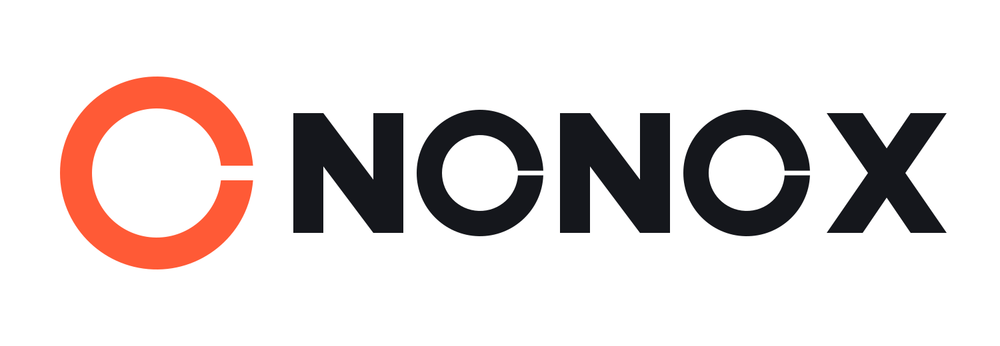

<div align="center">

<a href="https://nonox.app">
  <picture>
    <source media="(prefers-color-scheme: dark)" srcset="public/brand/nonox-light.svg">
    
  </picture>
</a>

### Bokföring med öppen källkod för svenska företag

Bokföring, fakturor, moms, bokslut, lön och personalliggare i ett system.<br>
Du äger din data, kan granska varje rad kod och alltid ta med dig allt ut.

[](https://github.com/STAFE-GROUP-AB/nonox/actions/workflows/ci.yml)
[](https://github.com/STAFE-GROUP-AB/nonox/releases)
[](LICENSE)
[](https://www.php.net)
[](https://laravel.com)
[](https://www.postgresql.org)

**[nonox.app](https://nonox.app)** · [Manual](https://nonox.app/manual) · [Säkerhet och regelverk](https://nonox.app/sakerhet) · [Flytta hit](https://nonox.app/flytta-hit) · [Branscher](https://nonox.app/branscher) · [Systemdokumentation](docs/systemdokumentation/README.md) · [Bidra](CONTRIBUTING.md)

</div>

---

## Varför NONOX

- **Öppet.** All affärslogik är öppen källkod under AGPL-3.0. Vem som helst kan granska exakt hur siffrorna hanteras.
- **Korrekt.** Byggt efter Bokföringslagen, BFNAR 2013:2 och Skatteverkets regler. En bokförd verifikation kan aldrig ändras, varken i appen eller direkt i databasen.
- **Ditt.** Exportera allt när som helst: SIE4, underlag, fakturor och lönehistorik. Kör det själv eller låt oss sköta driften i Sverige.
- **Säkert och ärligt redovisat.** Vi granskar säkerheten och efterlevnaden av GDPR, AI-förordningen och andra regelverk och [publicerar resultatet](https://nonox.app/sakerhet), även det som återstår.

## Teknik

[Laravel 13](https://laravel.com), [Livewire 4](https://livewire.laravel.com), [Alpine.js](https://alpinejs.dev), [Tailwind CSS 4](https://tailwindcss.com) och [Laravel Jetstream](https://jetstream.laravel.com) för användare och företag, med **PostgreSQL** som databas. Testat med [Pest](https://pestphp.com), statisk analys med [Larastan](https://github.com/larastan/larastan) på nivå 8.

<details>
<summary><strong>In English</strong></summary>

NONOX is an open-source (AGPL-3.0) bookkeeping, invoicing, VAT, year-end and payroll system for Swedish companies, built with Laravel and PostgreSQL. Posted vouchers are immutable at the database level, every action is written to an append-only audit log, and everything can be exported as SIE4, CSV and PDF. The user interface is in Swedish; code, comments and commits are in English. See [CONTRIBUTING.md](CONTRIBUTING.md) to contribute and [SECURITY.md](SECURITY.md) to report a vulnerability.

</details>

## Funktioner

Grupperat som i menyn i appen. Moduler slår varje företag på och av under Företagsinställningar → Moduler, utan att något raderas.

### Översikt
- Nyckeltal för företagaren (företagskontot, obetalda kundfakturor, att betala och momsen med sista dag), "Att göra" i den ordning det brådskar med en länk direkt till uppgiften, och de senaste verifikationerna. Var och en visas bara för roller som får se underlaget. Översikten sparas i cache och laddas om med en knapp.
- **Statistik och prognos:** intäkter och kostnader mot förra året, resultat per månad, likviditet med en tremånadersprognos som förklaras under diagrammet, största kunder och kostnader, och moms per månad. Varje diagram går att visa som tabell.
- **App på hemskärmen:** NONOX installeras som app på hemskärmen i mobilen, på surfplattan och datorn direkt från webbläsaren (PWA), utan App Store eller Google Play. Anställda som bara har Min sida får en egen app som öppnar Min sida. Utan internet visas en sida som säger det; ingen bokföring eller personuppgift sparas i enheten. Personalliggarens kiosk är en egen app som fungerar utan internet.
- **Sök med ⌘K:** en sökning över allt du har behörighet att se: sidor och åtgärder, verifikationer, fakturor (nummer, OCR, belopp), kunder, leverantörer, konton, lön, personalliggare och inkorg. Den förstår filter som "faktura 1029", "> 10000 kr", "obetald" och "oktober".

### Mina företag och uppgifter
- För redovisningsbyråer och ägare med flera bolag: summor och en gemensam "Att göra" för alla klienter, med filter per konsult, deadline och typ, och sparade vyer. Sista dag för moms och AGI, ansvarig konsult och byråns egna anteckningar.
- **Månadsstängning:** en rad per klient med bankavstämning, leverantörs- och kundfakturor, moms, lön och AGI, periodiseringar och rapport, som fylls i från bokföringen där det går.
- **Uppgifter** (`/uppgifter`): delegera mellan byrån och kundens användare åt båda hållen, med kommentarer, checklistor, återkommande uppgifter (till exempel moms varje månad), notiser och ett valfritt dagligt mejl.

### Försäljning
- Fakturor med OCR-nummer, PDF och utskick via e-post, bokförda automatiskt enligt fakturametoden eller kontantmetoden.
- Offerter och order som blir fakturor utan att något skrivs två gånger, och avtalsfakturering varje månad, kvartal, halvår eller år.
- Inbetalningar och delbetalningar, kreditfakturor och påminnelser. Bankens fil med inbetalningar (ISO 20022 camt.054) läses in och matchas på OCR-numret.
- ROT- och RUT-avdrag, omvänd betalningsskyldighet för byggtjänster, och fakturor till andra EU-länder och export med rätt konto, momsruta och fakturatext.

### Inköp
- Leverantörsfakturor som PDF eller bild, kontering per kostnadsställe och attest av en annan person än den som registrerade. Fakturor i utländsk valuta räknas om med Riksbankens kurs, och kursvinst eller kursförlust bokförs när fakturan betalas.
- Betalfiler till banken (ISO 20022 pain.001) för Danske Bank, Handelsbanken, Länsförsäkringar, Nordea, SEB, Swedbank och sparbankerna. En betalfil godkänns av en annan person innan den kan laddas ner, och bokförs när banken har betalat.
- En tolkad faktura kopplas till leverantören som redan finns i registret, även en utländsk utan organisationsnummer (momsnummer, IBAN, e-postdomän eller namn), och ett liknande namn föreslås i stället för att leverantören läggs till igen.
- Kreditnotor från leverantörer, inköp från andra EU-länder, tjänster från länder utanför EU och omvänd betalningsskyldighet, med momsen i rätt rutor.

### Register
- Kunder, artiklar och leverantörer med pris, moms och konto. Per kund syns vad den fakturerats i år och vad som är obetalt.
- **Hämta uppgifter med organisationsnumret:** namn, adress och företagsform hämtas från Bolagsverket när du lägger till ett företag, en kund eller en leverantör, och i företagsinställningarna. Numret kontrolleras först, svaret är ett förslag, och det du redan skrivit ändras bara om du väljer det. Avregistrerade företag och pågående konkurs eller likvidation visas. Leverantörens momsregistreringsnummer kan kontrolleras i VIES. Kräver API-uppgifter från Bolagsverket (gratis); utan dem syns knappen inte.

### Bokföring
- **Löpande:** verifikationer med obruten numrering, utkast, rättelser, konteringsmallar och underlag som kan fotograferas med mobilen. Kontosaldot syns direkt när du väljer konto och efter varje rad. Bankavstämning, periodiseringar, anläggningsregister med avskrivningar (tillgången kan skapas direkt när inköpet bokförs), och inläsning av SIE4 i två steg med avstämning.
- **Rapporter och moms:** saldobalans, resultat- och balansrapport, huvudbok, kontoanalys och verifikationslista per period och kostnadsställe, som PDF och CSV. Klicka på ett konto för att se dess huvudbok och vidare till verifikationen. Momsdeklaration med fil till Skatteverket, och EU-rapporter: periodisk sammanställning, underlag för OSS och VIES-kontroll.
- **Bokslut:** räkenskapsår och årsskifte, bokslut med checklista och låsning, årsredovisning enligt K2 som PDF, och inkomstdeklaration 2 som SRU-filer.
- **Inställningar:** kontoplan enligt BAS 2026, verifikationsserier, kostnadsställen och projekt.
- En bokförd verifikation kan aldrig ändras, och databasen själv vägrar. En kedja av kontrollsummor avslöjar ändringar i efterhand och kontrolleras varje natt.

### Lön (modul)
- Anställda, Skatteverkets skattetabeller, månads- och timlön, frånvaro, sjuklön med karensavdrag och arbetsgivaravgifter med sänkningen för unga. Timlön räknas från godkända tidrapporter, även från personalliggaren. Godkända timmar från tidigare månader som ingen lönekörning betalat blir en fråga i nästa lönekörning: ta med dem nu eller inte än.
- Lönekörning med attest, lönebesked som PDF, lönefil till banken och bokföring i serie L.
- Löneunderlag från schemasystem som PAXml eller CSV: timmar, OB och tillägg blir förslag i lönekörningen, koderna kopplas till lönearter en gång per system, och en person godkänner raderna innan de kommer med i lönen.
- Semester enligt semesterlagen, förmåner, traktamente och milersättning, tjänstepension, utlägg med kvitto, lönerevision och slutlön.
- Arbetsgivardeklaration (AGI) som XML enligt Skatteverkets schema, och ett lönearkiv som finns kvar när modulen stängs av.
- Min sida för anställda: lönebesked, sjukanmälan, vård av barn, semesteransökan och utlägg.

### Avtal (modul)
- Kollektivavtal i lönen: avtalets värden som versionerad data med källa till parternas egna texter, aldrig som avtalstext. Data för Gröna Riks (medlem och hängavtal), Besöksnäringens tjänstemannaavtal, Detaljhandeln, Handelns tjänstemannaavtal, Lager och E-handel, bageriavtalet och Frisöravtalet.
- En avtalsversion används först när en namngiven person har jämfört den med källorna; till dess stoppas lönekörningen för de anställda som omfattas. Frisöravtalets värden kan inte kontrolleras förrän 2025 års text är publik.
- Företaget väljer avtal och om det är bundet som medlem eller genom hängavtal; varje anställning får avtal, lönegrupp och branschvana.
- Redan uppdelade timmar för OB och övertid, inmatade eller från en löneunderlagsfil, prissätts med avtalets sats för arbetsdagen, och lönebeskedet visar version och källa. Minimilönen kontrolleras per lönegrupp, ålder och branschvana och ger en varning på lönekörningen. Avtalskalender med aftnar och storhelger.
- Med NONOX AI påslaget läses hängavtal och anställningsavtal som text där personnummer, bankuppgifter och adresser är dolda, och AI:n föreslår avtal, lönegrupp och andra uppgifter med citat och sida. Inget förs in förrän en person godkänner det.
- Inte byggt ännu: OB räknat direkt från passens klockslag, övertid mot schemat, komptid, avtalets semester- och sjuklöneregler, pension och avtalsförsäkringar per avtal.

### Personalliggare (modul)
- Lokaler och personal med in- och utcheckning i en kiosk på en surfplatta, som fungerar även utan internet, med kod, personlig QR-kod eller mobil incheckning.
- Liggaren skrivs bara till, med en kedja av kontrollsummor och rättelser som syns bredvid originalet. Kontrollbesöket ("Skatteverket är här") visar och exporterar liggaren.
- Kiosken sparar aldrig koderna. Personnummer för kontrollbesöket utan internet sparas bara krypterade och öppnas med en chefs kod.

### Inkorg (modul)
- En egen e-postadress per företag för leverantörsfakturor, kvitton och dagsrapporter från kassasystem. Avsändaren kontrolleras (SPF, DKIM, DMARC), farliga bilagor spärras och alla bilagor virussöks innan något läses. Skräppost från okända avsändare sparas aldrig.
- Bara post från godkända avsändare tolkas; annat väntar i karantän tills någon godkänner avsändaren.
- Peppol-fakturor, SIE-filer och dagsrapporter läses utan AI, med mallar som en person godkänt.
- Gallring: avvisad post tas bort efter 7 dagar, och karantän som ingen hanterat efter 90 dagar.

### NONOX Connect – öppet API (modul)
- Ett API för andra program: kontoplan, momskoder, räkenskapsår och låsta perioder, verifikationer (utkast, bokföring, rättelse och underlag), kunder, artiklar, kostnadsställen och projekt, kundfakturor (utkast, skapa, mejla, kreditera, betalningar och PDF), leverantörsfakturor (registrering, attest av någon annan och betalning), in- och utbetalningar, rapporter, momsdeklaration per period och SIE-export. Beskrivet i OpenAPI med exempel och dokumenterat för utvecklare på [nonox.app/utvecklare](https://nonox.app/utvecklare) (guider, referens och kodexempel i curl, PHP, JavaScript och Python, på svenska och engelska) och i [docs/api](docs/api/README.md). Gratis, utan tilläggsavgift.
- Appar ansluts med OAuth 2.0 (med PKCE) och godkänns av en ägare eller administratör med passkey, ett företag i taget. API-nycklar för egna skript har alltid ett slutdatum och visas bara en gång.
- En anslutning får aldrig mer än personen som gav den får göra just då. Varje skrivning kräver en Idempotency-Key och loggas.
- Öppet API med webhooks som signeras: bokförd verifikation, mejlad faktura, betald faktura och attesterad leverantörsfaktura skickas till en https-adress efter att bokföringen sparats, med skydd mot anrop till interna nät och nya försök i ett dygn.
- Testföretag med påhittade uppgifter för den som vill prova API:t, tydligt märkta och utan utskick.

### Bank (modul)
- Företagets bankkonton kopplas med BankID genom öppen bankdata (PSD2), och transaktioner och saldon hämtas automatiskt en till fyra gånger per dygn i stället för att filer laddas upp. NONOX kan bara läsa, aldrig betala; betalfiler signeras fortfarande i banken.
- Varje bankkonto kopplas till ett konto i bokföringen (till exempel 1930). Transaktionerna föreslås mot bokförda rader och inbetalningar mot obetalda fakturor, och bankens saldo fylls i bankavstämningen. En person bekräftar alltid; modulen bokför aldrig själv.
- Påminnelse med e-post och under Att göra innan medgivandet går ut (högst 180 dagar), och bortkoppling när som helst. Kräver att den som driftar NONOX har avtal med Enable Banking; i den driftade tjänsten slås modulen på när de juridiska frågorna är besvarade.

### NONOX AI (modul)
- Läser leverantörsfakturor, kvitton och utlägg direkt när de laddats upp eller fotograferats, och föreslår konton och belopp med företagets egen nyckel till OpenAI, Claude eller Gemini. En person kontrollerar och sparar alltid, AI:n sparar aldrig själv. Kvitton från anställda läses bara; AI:n bedömer aldrig inköpet eller personen.

### Företaget och din data
- Flera företag per användare med roller: ägare, administratör, redovisningskonsult, bokförare, attestant och revisor. Ägarskap kan föras över, och ett företag kan arkiveras så att det bara kan läsas.
- Passkey som andra steg vid inloggning för den som kan se sjukfrånvaro, lönebesked eller fullständiga personnummer. Ägaren kan kräva passkey för alla i företaget.
- Export av allt när som helst. Arkivpaket per räkenskapsår med SIE-fil, rapporter, underlag, fakturor och behandlingshistorik, med kontrollsumma för varje fil, som går att läsa utan NONOX.
- Behandlingshistorik över allt som görs, och dataskydd: registerutdrag, radering av eget konto, gallring och personuppgiftsbiträdesavtal.
- Eget varumärke: logga och färger på fakturor, lönebesked och Min sida.
- Redovisningsbyråns varumärke: en byrå kan visa sin logga och sina färger för sina kunder i appen, på Min sida och i mejlen om inloggning och uppgifter. Kunden väljer själv sin byrå, kopplingen ger byrån ingen behörighet, och kundens egna fakturor och lönebesked behåller kundens varumärke.
- Flytta hit: flyttguide steg för steg och direkt flytt från Fortnox via deras API.

### På väg
- Automatisk avstämning av betalfiler mot bankens svar, och betalfiler och kundfakturor i utländsk valuta.
- Import av varor från länder utanför EU.
- Digital inlämning av årsredovisningen till Bolagsverket (iXBRL).
- Färdiga kopplingar från kassasystem och e-handel, direkt eller via de integrationsplattformar som programmen redan använder. API:t och webhooks finns; kopplingarna byggs mot dem.

Hela planen och alla regler finns i [AGENTS.md](AGENTS.md).

### Juridiska krav (Sverige)

Systemet byggs för att uppfylla bokföringslagen (BFL), BFNAR 2013:2 (systemdokumentation och behandlingshistorik), Skatteverkets momsregler och kravet att spara räkenskapsinformation i sju år. Hur systemet faktiskt fungerar beskrivs i [systemdokumentationen](docs/systemdokumentation/README.md). Frågor som ännu inte är juridiskt kontrollerade är markerade med `TODO(legal-verify)` och listade där.

## Installation

Den här guiden förutsätter inga förkunskaper. Följ stegen uppifrån och ned; varje steg säger vad du ska se när det har gått rätt.

### Vad finns i appen i dag?

Var medveten om var projektet står innan du installerar:

- **Fungerar:** allt under [Funktioner](#funktioner) ovan.
- **Inte byggt ännu:** det som står under [På väg](#på-väg).

### 1. Installera verktygen (en gång per dator)

Du behöver PHP 8.4 eller senare, Composer, Node.js 20 eller senare samt PostgreSQL 16 eller senare.

**Enklast på Mac och Windows: [Laravel Herd](https://herd.laravel.com)**

1. Ladda ned och installera Herd. Då får du PHP, Composer och Node.js på en gång.
2. Du behöver även PostgreSQL:
   - **Herd Pro:** öppna Herd → *Services* → *+* → välj **PostgreSQL** → starta tjänsten. Notera **porten** som står bredvid (oftast `5432`).
   - **Gratisversionen av Herd:** installera [DBngin](https://dbngin.com) (gratis), skapa en PostgreSQL-tjänst och tryck *Start*. Användarnamnet och porten står i DBngin.

**Linux eller utan Herd:** installera `php` (8.4+, med tilläggen `pdo_pgsql`, `mbstring`, `xml`, `curl`, `zip`, `bcmath`, `intl`), [Composer](https://getcomposer.org/download/), [Node.js](https://nodejs.org) och `postgresql` via din pakethanterare.

Kontrollera i Terminalen att allt finns:

```bash
php -v        # ska visa 8.4 eller högre
composer -V
node -v       # ska visa v20 eller högre
psql --version  # ska visa 16 eller högre
```

### 2. Hämta koden

Med Herd: lägg projektet i mappen `~/Herd` så får det automatiskt adressen `http://nonox.test`.

```bash
cd ~/Herd                                   # utan Herd: valfri mapp
git clone https://github.com/STAFE-GROUP-AB/nonox.git
cd nonox
```

> Mappnamnet styr adressen i Herd: mappen `nonox` blir `http://nonox.test`.

### 3. Skapa databasen

Först behöver du veta vilket **användarnamn** din PostgreSQL har:

- **Herd Pro:** oftast samma som ditt användarnamn på datorn. Kör `whoami` i Terminalen så ser du det.
- **DBngin, Docker och Linux:** oftast `postgres`.

Skapa sedan databasen (byt `DITT_ANVÄNDARNAMN` mot det du fick fram ovan):

```bash
psql -h 127.0.0.1 -p 5432 -U DITT_ANVÄNDARNAMN -d postgres -c "CREATE DATABASE nonox;"
```

Svaret `CREATE DATABASE` betyder att det gick bra. Byt `5432` mot porten från steg 1 om den är en annan.

Föredrar du ett grafiskt program går det lika bra att skapa databasen `nonox` i TablePlus, Postico eller liknande.

> Osäker? Hoppa vidare. Startsidan i steg 5 kontrollerar databasen och skriver ut exakt vilket kommando som saknas.

### 4. Installera appen

```bash
composer install
cp .env.example .env
```

Öppna nu filen `.env` i en textredigerare. Den är inställd för en server, så ändra först tre rader för din egen dator:

```dotenv
APP_ENV=local        # guiden för första start och automatisk inloggningskod fungerar bara lokalt
APP_DEBUG=true       # visar felets detaljer i webbläsaren, aldrig på en server
OTP_AUTOFILL=true    # fyller i inloggningskoden åt dig
```

`OTP_AUTOFILL=true` hoppar också över passkey-steget lokalt, eftersom passkeys kräver en säker adress och `http://….test` inte är det. Vill du prova passkeys lokalt: sätt `PASSKEYS_SKIP_LOCALLY=false` och öppna NONOX på `http://localhost:8000` (`php artisan serve`, med `APP_URL=http://localhost:8000`).

Fyll sedan i ditt användarnamn från steg 3 på raden `DB_USERNAME`:

```dotenv
DB_CONNECTION=pgsql
DB_HOST=127.0.0.1
DB_PORT=5432        # ändra om din PostgreSQL har en annan port
DB_DATABASE=nonox
DB_USERNAME=postgres  # byt mot ditt användarnamn från steg 3
DB_PASSWORD=        # fyll i om din PostgreSQL har lösenord
```

Kör sedan installationen. Ett kommando gör resten:

```bash
composer setup
```

Det skapar applikationsnyckeln, bygger alla tabeller och bygger webbsidans utseende. Det tar någon minut första gången. Allt har gått rätt om det sista som skrivs ut är `✓ built in …`.

### 5. Öppna appen

- **Med Herd:** gå till **http://nonox.test** i webbläsaren. Klart, ingen server behöver startas.
- **Utan Herd:** kör `php artisan serve` och gå till **http://localhost:8000**. Låt Terminalfönstret vara öppet så länge du använder appen. Ändra också `APP_URL=http://localhost:8000` i `.env`.

Första gången möts du av en **guide i tre steg**:

1. **Ditt företag:** namn, organisationsnummer, företagsform, moms och när räkenskapsåret börjar.
2. **Du:** ditt namn och din e-postadress. Det är den adressen du loggar in med.
3. **Bekräfta e-posten** med en kod. På din egen dator fylls koden i automatiskt.

Sedan är du inne i ditt företag. Saknas något tekniskt (till exempel databasen) förklarar startsidan i stället vad som är fel och visar exakt en rad att klistra in i Terminalen.

När systemet är installerat visar `/` en **publik startsida** (även innan första användaren finns; en ny e-postadress skapar ett konto) om NONOX för den som inte är inloggad, med länken *Logga in* uppe till höger. Vill du att besökare hamnar direkt på inloggningen, till exempel på en byrås egen installation, sätter du `NONOX_LANDING_PAGE=false` i `.env`. Den publika versionen körs på https://nonox.app. Kontaktlänk, villkor, integritetspolicy och företagsnamn i sidfoten ställs in med `NONOX_CONTACT_URL`, `NONOX_TERMS_URL`, `NONOX_PRIVACY_URL`, `NONOX_COMPANY_NAME` och `NONOX_COMPANY_ORG_NUMBER`. Länkar som saknas visas inte.

> Guiden går bara att använda på en lokal installation (`APP_ENV=local`) som inte har några användare ännu. På en server kan ingen utomstående alltså ta över en nyinstallerad version.

### Så loggar du in

Det finns inga lösenord. Du skriver din e-postadress, får en kod med åtta siffror i mejlet och skriver in den. Är adressen ny skapas ett konto, och du får sedan skapa ditt företag på sidan *Kom igång*.

**Lokalt är det ett klick.** När `APP_ENV=local` och `OTP_AUTOFILL=true` (de rader du ändrade i steg 4) och `APP_URL` pekar på `localhost` eller en `.test`-adress är e-postfältet redan ifyllt med din adress, och koden fylls i och kontrolleras automatiskt.

Vill du logga in med en annan adress lokalt hamnar koden i loggfilen, eftersom `MAIL_MAILER=log`:

```bash
grep -A30 "Subject: Din inloggningskod" storage/logs/laravel.log | grep -oE "\b[0-9]{8}\b" | tail -1
```

> ⚠️ Sätt aldrig `APP_ENV=local` på en server som nås från internet. På en server behöver du riktig e-post (`MAIL_MAILER=smtp` med uppgifter från din e-postleverantör), annars kommer koderna aldrig fram.

### Köra NONOX på en server

`.env.example` är redan inställd för en server (`APP_ENV=production`, `APP_DEBUG=false`, `OTP_AUTOFILL=false`). Ändra inte de raderna där. Det du behöver fylla i:

- `APP_URL` med serverns riktiga adress (`https://…`).
- Riktig e-post, till exempel `MAIL_MAILER=smtp` eller `mailgun`. Med `log` kommer inga inloggningskoder fram.
- **Bakom en proxy eller CDN** (till exempel Cloudflare med orange moln, eller en lastbalanserare): skriv proxyns adressintervall, kommaseparerade, i `TRUSTED_PROXIES`. Annars ser NONOX proxyns adress i stället för besökarens, och spärrarna mot för många inloggningsförsök slår mot alla besökare samtidigt. För Cloudflare finns intervallen på https://www.cloudflare.com/ips/. Lämnas raden tom litar NONOX inte på någon proxy, vilket är rätt när ingen proxy används. Skriv aldrig `*` om servern också går att nå utan proxyn, för då kan vem som helst ange sin egen adress.
- För det öppna API:t (modulen NONOX Connect): kör `php artisan passport:keys` en gång, eller sätt `PASSPORT_PRIVATE_KEY` och `PASSPORT_PUBLIC_KEY`. Utan nycklar går modulen inte att slå på. Appar registreras med `php artisan connect:app "Namn" https://app.example/callback`. Gränserna för antal anrop och tokens livslängd ställs in med `NONOX_CONNECT_*`, se `.env.example` och [docs/api](docs/api/README.md). API-nycklar och tokens fungerar bara mot `/api/v1`, aldrig mot vanliga sidor.
- För att hämta företagsuppgifter med organisationsnumret (frivilligt): anmäl dig som API-kund hos Bolagsverket för *API för värdefulla datamängder* (gratis), och sätt `COMPANY_REGISTRY_DRIVER=bolagsverket`, `BOLAGSVERKET_CLIENT_ID`, `BOLAGSVERKET_CLIENT_SECRET` och `BOLAGSVERKET_ENVIRONMENT` (`test` eller `prod`). Utan dem syns inte knappen *Hämta uppgifter*. Se [ADR-035](docs/adr/ADR-035-company-lookup.md).

Kör `php artisan config:cache` efter varje ändring i `.env` på servern.

### Uppdatera till senaste versionen

```bash
git pull
composer install
php artisan migrate
npm install && npm run build
```

### Felsökning

| Felmeddelande | Orsak och lösning |
|---|---|
| `Connection refused` | PostgreSQL är inte startat, eller fel port i `.env`. Starta PostgreSQL i Herd/DBngin och kontrollera `DB_PORT`. |
| `database "nonox" does not exist` | Databasen är inte skapad. Gör steg 3. |
| `role "…" does not exist` | Fel användarnamn. Ändra `DB_USERNAME` i `.env` (se steg 3). |
| `password authentication failed` | Fel lösenord. Fyll i `DB_PASSWORD` i `.env`. |
| `Please provide a valid cache path` | Mapparna under `storage/` saknas. Kör `mkdir -p storage/framework/{cache/data,sessions,views} storage/logs` och försök igen. |
| `Vite manifest not found` | CSS/JS är inte byggt. Kör `npm install && npm run build`. |
| `nonox.test` öppnar inte | Projektet ligger inte i en mapp som Herd bevakar. Flytta det till `~/Herd`, eller kör `herd link nonox` i projektmappen. |
| Sidan visar bara ett fel utan detaljer | Läs `storage/logs/laravel.log`, där står det verkliga felet. |
| Något är konstigt efter en uppdatering | Kör `php artisan optimize:clear`. |

## Dokumentation

- [Systemdokumentation](docs/systemdokumentation/README.md) – hur bokföringen fungerar, som bokföringslagen kräver. Uppdateras med varje ändring.
- [Beslut (ADR)](docs/adr/) – varför systemet är byggt som det är: verifikationer, SIE, kostnadsställen, rapporter och moms.
- [Manual](https://nonox.app/manual) – manualen för användare: kom igång, bokföring, fakturor, moms, bokslut, lön och en egen del för anställda (Min sida och personalliggaren), med sök. Artiklarna skrivs i Markdown i [docs/manual/sv](docs/manual/sv) enligt [skrivreglerna](docs/manual/SKRIVREGLER.md). Knappen **Hjälp** i appen öppnar artikeln om sidan du står på.
- [Utvecklare och API](https://nonox.app/utvecklare) – den publika utvecklarwebben för NONOX Connect: guider, en referens som genereras från [docs/api/openapi.yaml](docs/api/openapi.yaml), kodexempel och [ändringar](docs/api/CHANGELOG.md). Guiderna ligger i [docs/api/guider](docs/api/guider), på svenska och engelska.
- [Branschsidor](docs/branscher/README.md) – sidorna per bransch på [nonox.app/branscher](https://nonox.app/branscher), deras adresser och reglerna för innehållet. Funktionerna de nämner kontrolleras mot listan ovan.
- [AGENTS.md](AGENTS.md) – specifikationen och reglerna för alla som bidrar, människor som AI.

## Säkerhet

- Varje företag ser bara sina egna uppgifter. Det prövas för varje tabell i en egen testsvit.
- Inloggning med engångskod via e-post, inga lösenord. Koderna har åtta siffror, sparas bara som kontrollvärden, gäller i 10 minuter och en gång.
- Den som kan se sjukfrånvaro, lönebesked eller fullständiga personnummer bekräftar dessutom inloggningen med en passkey (fingeravtryck, ansiktsigenkänning eller skärmlås). Ägaren kan kräva passkey för alla i företaget. Se [ADR-029](docs/adr/ADR-029-passkeys.md).
- Bokförda verifikationer och behandlingshistoriken kan inte ändras, och en kedja av kontrollsummor kontrolleras varje natt.
- Filer och personnummer krypteras, och en strikt innehållspolicy stoppar skript från andra adresser.
- Säkerhetskopiorna återställs och kontrolleras varje vecka. Kör du själv gör `scripts/restore-test.sh` samma sak för dina kopior, se [säkerhetskopiering](docs/gdpr/sakerhetskopiering.md#återställningstest).
- Varje [release](https://github.com/STAFE-GROUP-AB/nonox/releases) har en förteckning över programvarukomponenterna (SBOM, CycloneDX) som bilaga.

Den senaste granskningen, med betyg per område och det som återstår, finns på [nonox.app/sakerhet](https://nonox.app/sakerhet). Hittar du en säkerhetsbrist? Följ [SECURITY.md](SECURITY.md) och rapportera den där, inte i ett öppet ärende. Dataskydd och juridik: [docs/gdpr](docs/gdpr/README.md) och [docs/juridik](docs/juridik/regelverk.md).

## Utveckling

### Köra tester

Testerna körs med [Pest](https://pestphp.com) mot en **egen** PostgreSQL-databas, `nonox_test`, så att dina riktiga data aldrig rörs. Varje test körs i en transaktion som rullas tillbaka efteråt.

Skapa testdatabasen och bygg tabellerna en gång:

```bash
psql -h 127.0.0.1 -p 5432 -U DITT_ANVÄNDARNAMN -d postgres -c "CREATE DATABASE nonox_test;"
DB_DATABASE=nonox_test php artisan migrate --force
```

Kör `DB_DATABASE=nonox_test php artisan migrate --force` igen när nya migrationer har tillkommit.

### Demoföretag per bransch

Ett påhittat demoföretag för varje branschsida (restaurang, café, butik, frisör, hantverkare, konsult, redovisningsbyrå och ekonomikonsult), med årets bokföring fram till i går: dagsrapporter eller kundfakturor (med ROT och omvänd betalningsskyldighet hos hantverkaren), leverantörsfakturor med attest och betalning, löner, momsdeklarationer, anställda och personalliggare. Byråerna är kopplade till sina kundföretag.

Lägg dem i en egen databas, så att de inte blandas med riktiga företag:

```bash
DB_DATABASE=nonox_demo php artisan migrate --force
DB_DATABASE=nonox_demo php artisan db:seed --class=IndustryDemoSeeder --force
```

Seedern tar ett par minuter och lägger bara till: ett företag som redan finns hoppas över. Den vägrar köra i produktion. Du loggar in med `ADMIN_EMAIL`, som äger företagen och är administratör i byråerna. Byråerna ägs av `redovisningsbyra@example.test` och `ekonomikonsult@example.test`. Alla namn och organisations- och personnummer är påhittade; datan finns i `database/seeders/Demo/DemoIndustries.php`.

### Kvalitetskontroll

Samma tre kontroller som körs i GitHub Actions vid varje push:

```bash
composer check      # alla tre i följd
composer lint       # kodstil (Pint)
composer analyse    # statisk analys (Larastan, nivå 8)
composer test       # tester (Pest)
npm test            # fakturaradernas uträkning i webbläsaren (Node)
```

Rätta kodstilen automatiskt med `./vendor/bin/pint`.

### Mobilen

Allt ska fungera på en telefon. `npm run check:mobile` öppnar sidorna i en riktig webbläsare i tre storlekar (iPhone 390 px, liten Android 360 px och iPad på höjden 768 px) och misslyckas om någon sida går att skrolla i sidled. En bred tabell ska skrolla inuti sitt kort, inte göra hela sidan bredare.

Skriptet loggar in via `/logga-in`, så kör det mot en lokal installation med `APP_ENV=local` och `OTP_AUTOFILL=true`. Det behöver Playwright, som inte är ett beroende i projektet:

```bash
npm install --no-save playwright && npx playwright install chromium
php artisan serve
npm run check:mobile                                       # mot http://127.0.0.1:8000
BASE_URL=http://oss.test npm run check:mobile              # mot en annan adress
ROUTES="/fakturor/ny /verifikationer/ny" npm run check:mobile  # bara vissa sidor
CHROME_PATH="/Applications/Google Chrome.app/Contents/MacOS/Google Chrome" npm run check:mobile
```

Sidor med id (en viss faktura eller verifikation) läggs till med `ROUTES` när det finns data att visa. Radredigerarna på fakturor, offerter, order, avtal, leverantörsfakturor och verifikationer är en tabell på större skärmar och ett kort per rad på telefonen; `tests/Feature/MobileLayoutTest.php` kontrollerar att det är så.

### Bygga Assets

```bash
# Utveckling (watch mode)
npm run dev

# Produktion
npm run build
```

## Principer

### Grundprinciper

1. **Deterministisk** - Samma input ger alltid samma output
2. **Testbar** - All affärslogik ska kunna testas
3. **Dokumenterad** - Tydlig dokumentation för alla funktioner
4. **Append-only** - Dataändringar som påverkar bokföring raderas aldrig

### Vad Systemet INTE Är

Medvetet utanför scope:

- ❌ ERP-system
- ❌ CRM
- ❌ Lagerhantering
- ❌ Kassasystem. NONOX bokför kassans dagsrapporter och SIE-filer, se Inkorg ovan, men sköter inte försäljningen.
- ❌ Inkasso

## Bidra

Alla är välkomna att skicka in pull requests. Läs [CONTRIBUTING.md](CONTRIBUTING.md) först: där står hur du sätter upp projektet, hur koden ska skrivas och vad som ska vara klart innan ett bidrag kan slås ihop. Reglerna som aldrig får brytas, till exempel att en bokförd verifikation aldrig ändras, finns i [AGENTS.md](AGENTS.md).

Pull requests granskas och slås ihop av projektets team. Varje version publiceras som en [release](https://github.com/STAFE-GROUP-AB/nonox/releases) med en tagg och en beskrivning av vad som ändrats.

> **Bygg tråkigt. Bygg korrekt. Bygg transparent.**

## Egen drift eller driftad tjänst

Du kan köra NONOX själv gratis, enligt licensen, och ansvarar då själv för drift, säkerhetskopior och personuppgifter. Eller så låter du oss sköta driften på [nonox.app](https://nonox.app), med avtal och personuppgiftsbiträdesavtal. Skillnaden beskrivs på [nonox.app/egen-drift](https://nonox.app/egen-drift).

## Licens

NONOX är licensierat under **GNU Affero General Public License v3.0 (AGPL-3.0)**, se [LICENSE](LICENSE). Du får använda, ändra och dela systemet fritt. Kör du en ändrad version som en tjänst åt andra måste du göra din källkod tillgänglig för dem på samma villkor.

---

<div align="center">

Utvecklat av [Stafe Development AB](https://stafe.se), en del av Stafe Group AB · [nonox.app](https://nonox.app)

</div>
